# Anexos

## Planos de la v3

Planos de fabricación de la v3 (código LI150-V3), con las cotas del modelo 3D. Cada plano está en PDF y en DXF, con las vistas en tamaño real, en la carpeta [`planos/v3`](https://github.com/Pablomonte/LibreIncu-150/tree/manual-v3/docs/planos/v3) del manual; el DXF tiene el mismo nombre que el PDF. Los detalles a otra escala van en otra hoja del mismo plano (H2, H3). Cotas en mm.

Miniaturas de los planos; cada una abre el PDF.

  <a href="planos/v3/LI150-V3-AP_arbol.pdf" title="LI150-V3-AP" style="text-align:center; font-size:0.7rem;">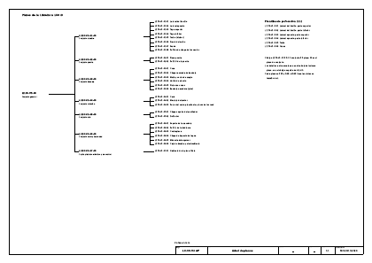AP</a>
  <a href="planos/v3/LI150-V3-00_conjunto-general.pdf" title="LI150-V3-00" style="text-align:center; font-size:0.7rem;">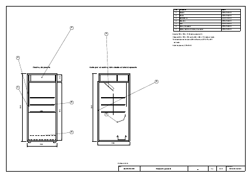00</a>

*Árbol de planos y conjunto general (LI150-V3-AP y 00).*

  <a href="planos/v3/LI150-V3-01-00_conjunto-mueble.pdf" title="LI150-V3-01-00" style="text-align:center; font-size:0.7rem;">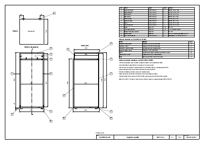01-00</a>
  <a href="planos/v3/LI150-V3-01-00-H2_conjunto-mueble-uniones.pdf" title="LI150-V3-01-00 H2" style="text-align:center; font-size:0.7rem;">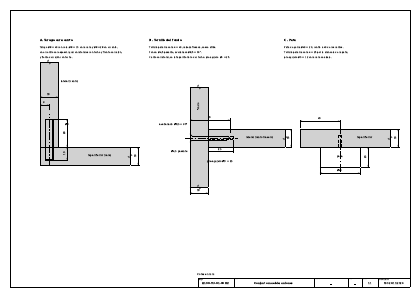01-00 H2</a>
  <a href="planos/v3/LI150-V3-01-00-H3_conjunto-mueble-despiece.pdf" title="LI150-V3-01-00 H3" style="text-align:center; font-size:0.7rem;">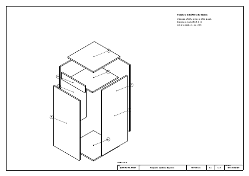01-00 H3</a>
  <a href="planos/v3/LI150-V3-01-01_lateral-del-husillo.pdf" title="LI150-V3-01-01" style="text-align:center; font-size:0.7rem;">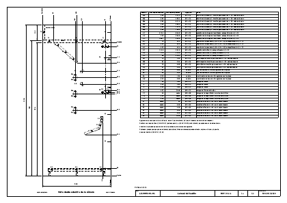01-01</a>
  <a href="planos/v3/LI150-V3-01-01-H2_lateral-del-husillo-zona-del-husillo.pdf" title="LI150-V3-01-01 H2" style="text-align:center; font-size:0.7rem;">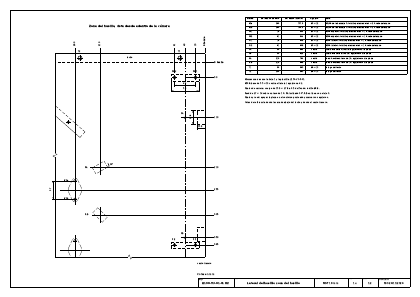01-01 H2</a>
  <a href="planos/v3/LI150-V3-01-02_lateral-opuesto.pdf" title="LI150-V3-01-02" style="text-align:center; font-size:0.7rem;">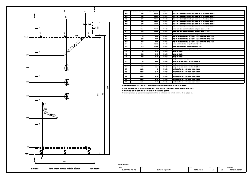01-02</a>
  <a href="planos/v3/LI150-V3-01-03_tapa-superior.pdf" title="LI150-V3-01-03" style="text-align:center; font-size:0.7rem;">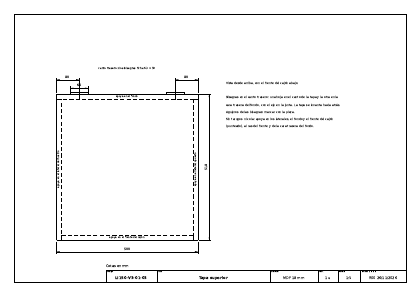01-03</a>
  <a href="planos/v3/LI150-V3-01-04_tapa-inferior.pdf" title="LI150-V3-01-04" style="text-align:center; font-size:0.7rem;">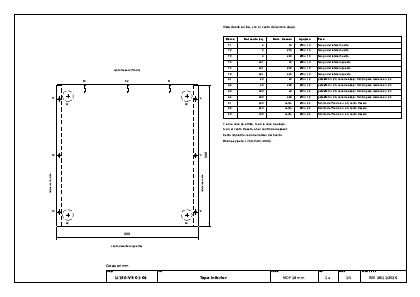01-04</a>
  <a href="planos/v3/LI150-V3-01-05_techo-divisor.pdf" title="LI150-V3-01-05" style="text-align:center; font-size:0.7rem;">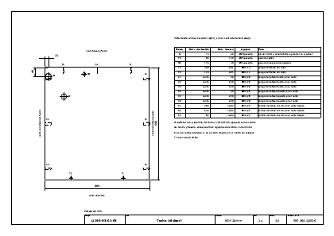01-05</a>
  <a href="planos/v3/LI150-V3-01-06_frente-del-cajon.pdf" title="LI150-V3-01-06" style="text-align:center; font-size:0.7rem;">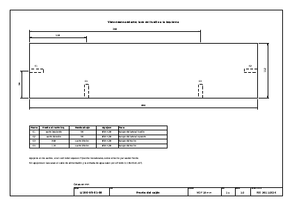01-06</a>
  <a href="planos/v3/LI150-V3-01-07_fondo.pdf" title="LI150-V3-01-07" style="text-align:center; font-size:0.7rem;">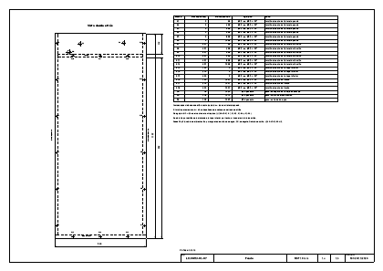01-07</a>
  <a href="planos/v3/LI150-V3-01-08_perfiles-de-chapa-de-los-cantos.pdf" title="LI150-V3-01-08" style="text-align:center; font-size:0.7rem;">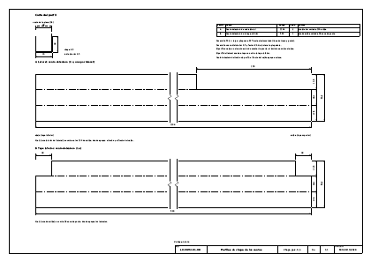01-08</a>

*Mueble (LI150-V3-01-00 a 01-08).*

  <a href="planos/v3/LI150-V3-02-00_conjunto-puerta.pdf" title="LI150-V3-02-00" style="text-align:center; font-size:0.7rem;">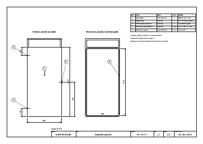02-00</a>
  <a href="planos/v3/LI150-V3-02-01_placa-puerta.pdf" title="LI150-V3-02-01" style="text-align:center; font-size:0.7rem;">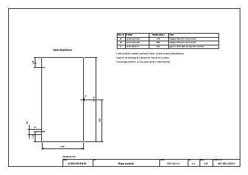02-01</a>
  <a href="planos/v3/LI150-V3-02-02_perfil-u-de-la-puerta.pdf" title="LI150-V3-02-02" style="text-align:center; font-size:0.7rem;">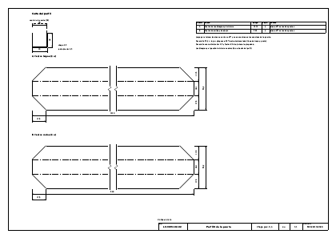02-02</a>

*Puerta (LI150-V3-02-00 a 02-02).*

  <a href="planos/v3/LI150-V3-03-01_cuna.pdf" title="LI150-V3-03-01" style="text-align:center; font-size:0.7rem;">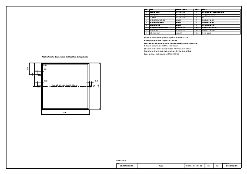03-01</a>
  <a href="planos/v3/LI150-V3-03-01-H2_cuna-brazos.pdf" title="LI150-V3-03-01 H2" style="text-align:center; font-size:0.7rem;">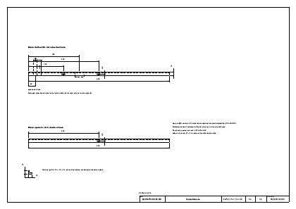03-01 H2</a>
  <a href="planos/v3/LI150-V3-03-02_chapa-ranurada-de-bandeja.pdf" title="LI150-V3-03-02" style="text-align:center; font-size:0.7rem;">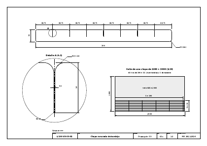03-02</a>
  <a href="planos/v3/LI150-V3-03-04_varilla-de-vinculo.pdf" title="LI150-V3-03-04" style="text-align:center; font-size:0.7rem;">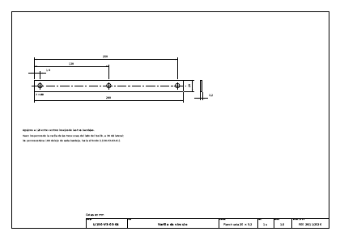03-04</a>

*Bandejas (LI150-V3-03-01 a 03-04).*

  <a href="planos/v3/LI150-V3-04-00_conjunto-rotacion.pdf" title="LI150-V3-04-00" style="text-align:center; font-size:0.7rem;">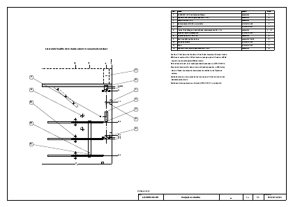04-00</a>
  <a href="planos/v3/LI150-V3-04-01_carro.pdf" title="LI150-V3-04-01" style="text-align:center; font-size:0.7rem;">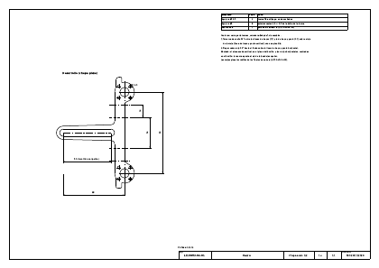04-01</a>
  <a href="planos/v3/LI150-V3-04-03_perno-planchuela-y-tacos.pdf" title="LI150-V3-04-03" style="text-align:center; font-size:0.7rem;">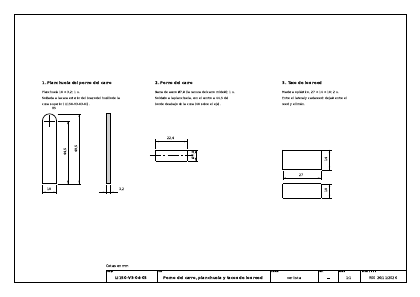04-03</a>

*Rotación (LI150-V3-04-00 a 04-03).*

  <a href="planos/v3/LI150-V3-05-00_conjunto-aire.pdf" title="LI150-V3-05-00" style="text-align:center; font-size:0.7rem;">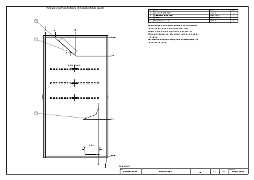05-00</a>
  <a href="planos/v3/LI150-V3-05-01_chapa-soporte-del-ventilador.pdf" title="LI150-V3-05-01" style="text-align:center; font-size:0.7rem;">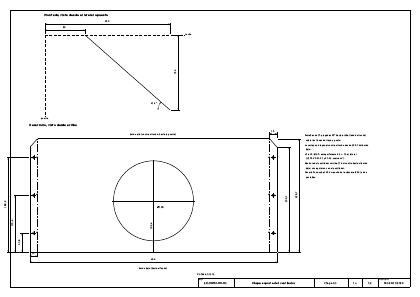05-01</a>
  <a href="planos/v3/LI150-V3-05-02_deflector.pdf" title="LI150-V3-05-02" style="text-align:center; font-size:0.7rem;">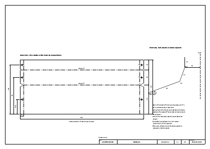05-02</a>

*Aire (LI150-V3-05-00 a 05-02).*

  <a href="planos/v3/LI150-V3-06-00_conjunto-calor-y-humedad.pdf" title="LI150-V3-06-00" style="text-align:center; font-size:0.7rem;">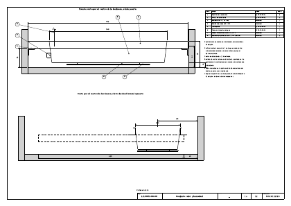06-00</a>
  <a href="planos/v3/LI150-V3-06-01_soporte-de-la-nacedora.pdf" title="LI150-V3-06-01" style="text-align:center; font-size:0.7rem;">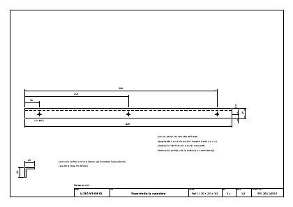06-01</a>
  <a href="planos/v3/LI150-V3-06-02_perfil-l-de-la-budinera.pdf" title="LI150-V3-06-02" style="text-align:center; font-size:0.7rem;">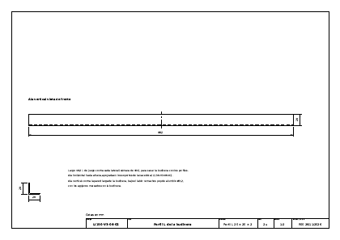06-02</a>
  <a href="planos/v3/LI150-V3-06-03_contraplaca.pdf" title="LI150-V3-06-03" style="text-align:center; font-size:0.7rem;">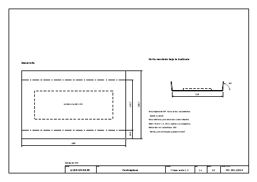06-03</a>
  <a href="planos/v3/LI150-V3-06-04_chapa-de-impacto-del-agua.pdf" title="LI150-V3-06-04" style="text-align:center; font-size:0.7rem;">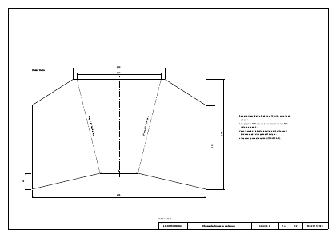06-04</a>

*Calor y humedad (LI150-V3-06-00 a 06-04).*

  <a href="planos/v3/LI150-V3-07-00_cajon-y-tablero.pdf" title="LI150-V3-07-00" style="text-align:center; font-size:0.7rem;">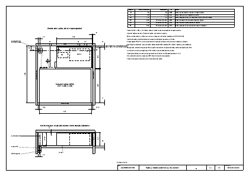07-00</a>

*Cajón y tablero (LI150-V3-07-00).*

## Archivos de fabricación

| Archivo | Pieza |
|---|---|
| [Deflector_Aire.dxf](cad/Deflector_Aire.dxf) | Desarrollo del deflector |
| [contraplaca_desarrollo.dxf](cad/contraplaca_desarrollo.dxf) | Desarrollo de la contraplaca |
| [carro_portatuercas_corredera-Body.dxf](cad/carro_portatuercas_corredera-Body.dxf) | Desarrollo del carro |
| [chapa_ranurada_bandeja.dxf](cad/chapa_ranurada_bandeja.dxf) | Chapa ranurada de la bandeja |
| [LibreIncu_Rediseno_Despiece.FCStd](https://github.com/Pablomonte/LibreIncu-150/blob/LibreIncu-150/fuentes/LibreIncu_Rediseno_Despiece.FCStd) | Modelo 3D de referencia de la v3 (FreeCAD) |

Los STEP del modelo están en [Vista 3D](vista-3d.md#descargas).
