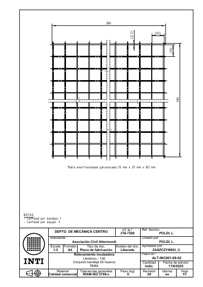
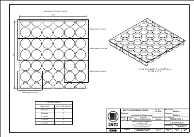
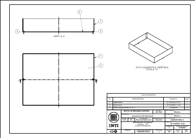
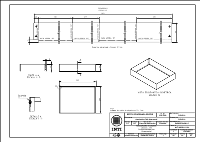
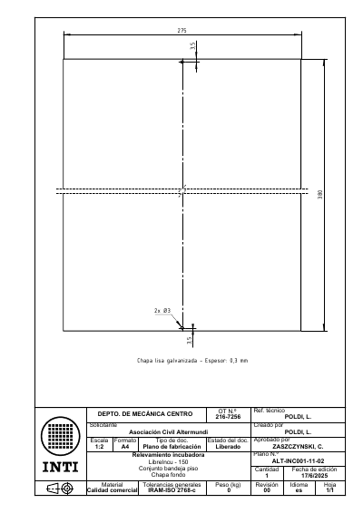
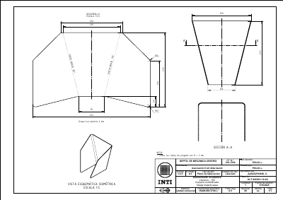

# Anexos

## Planos del INTI

Planos de fabricación del INTI (OT 216-7256, junio de 2025) de piezas que usa la v3. Están en la [carpeta de planos](https://github.com/Pablomonte/LibreIncu-150/tree/LibreIncu-150/HardWare/Mecanica) del repositorio.

| Plano | Pieza |
|---|---|
| ALT-INC001-09-02 | Malla de bandeja |
| ALT-INC001-09-03 | Cortes del maple plástico |
| ALT-INC001-11-00 a 11-02 | Bandeja nacedora (piso) |
| ALT-INC001-12-02 | Chapa de impacto del agua |

Miniaturas de los planos; cada una abre el PDF.

  <a href="https://github.com/Pablomonte/LibreIncu-150/blob/LibreIncu-150/HardWare/Mecanica/ALT-INC001-09-02.pdf" title="ALT-INC001-09-02" style="text-align:center; font-size:0.7rem;">09-02</a>
  <a href="https://github.com/Pablomonte/LibreIncu-150/blob/LibreIncu-150/HardWare/Mecanica/ALT-INC001-09-03.pdf" title="ALT-INC001-09-03" style="text-align:center; font-size:0.7rem;">09-03</a>

*Malla y cortes del maple (ALT-INC001-09-02 y 09-03).*

  <a href="https://github.com/Pablomonte/LibreIncu-150/blob/LibreIncu-150/HardWare/Mecanica/ALT-INC001-11-00.pdf" title="ALT-INC001-11-00" style="text-align:center; font-size:0.7rem;">11-00</a>
  <a href="https://github.com/Pablomonte/LibreIncu-150/blob/LibreIncu-150/HardWare/Mecanica/ALT-INC001-11-01.pdf" title="ALT-INC001-11-01" style="text-align:center; font-size:0.7rem;">11-01</a>
  <a href="https://github.com/Pablomonte/LibreIncu-150/blob/LibreIncu-150/HardWare/Mecanica/ALT-INC001-11-02.pdf" title="ALT-INC001-11-02" style="text-align:center; font-size:0.7rem;">11-02</a>

*Bandeja nacedora (ALT-INC001-11-00 a 11-02).*

  <a href="https://github.com/Pablomonte/LibreIncu-150/blob/LibreIncu-150/HardWare/Mecanica/ALT-INC001-12-02.pdf" title="ALT-INC001-12-02" style="text-align:center; font-size:0.7rem;">12-02</a>

*Chapa de impacto del agua (ALT-INC001-12-02).*

## Archivos de fabricación

| Archivo | Pieza |
|---|---|
| [Deflector_Aire.dxf](cad/Deflector_Aire.dxf) | Desarrollo del deflector |
| [contraplaca_desarrollo.dxf](cad/contraplaca_desarrollo.dxf) | Desarrollo de la contraplaca |
| [carro_portatuercas_corredera-Body.dxf](cad/carro_portatuercas_corredera-Body.dxf) | Desarrollo del carro |
| [chapa_ranurada_bandeja.dxf](cad/chapa_ranurada_bandeja.dxf) | Chapa ranurada de la bandeja |
| [LibreIncu_Rediseno_Despiece.FCStd](https://github.com/Pablomonte/LibreIncu-150/blob/LibreIncu-150/fuentes/LibreIncu_Rediseno_Despiece.FCStd) | Modelo 3D de referencia de la v3 (FreeCAD) |

Los STEP del modelo están en [Vista 3D](vista-3d.md#descargas).
