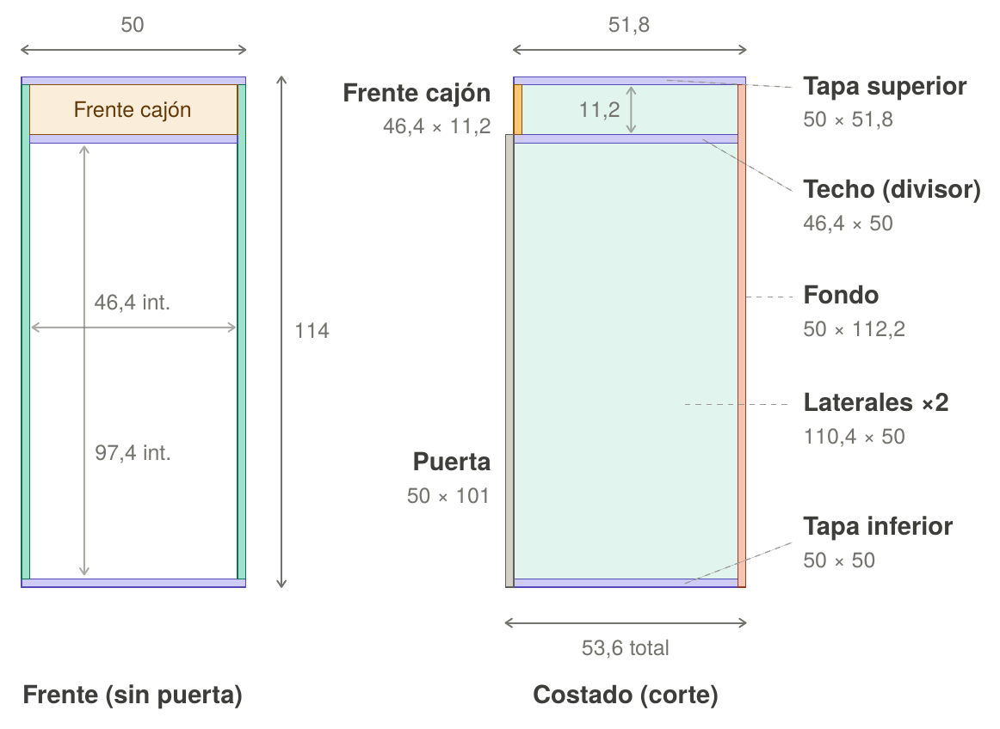
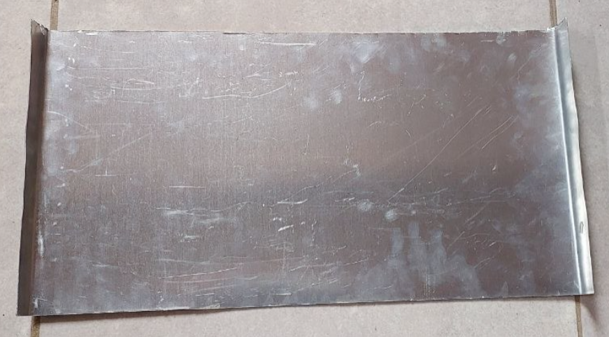
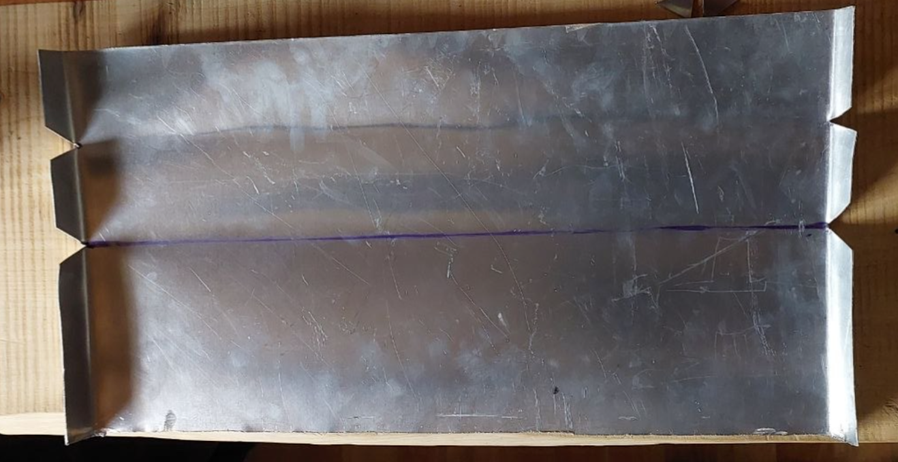
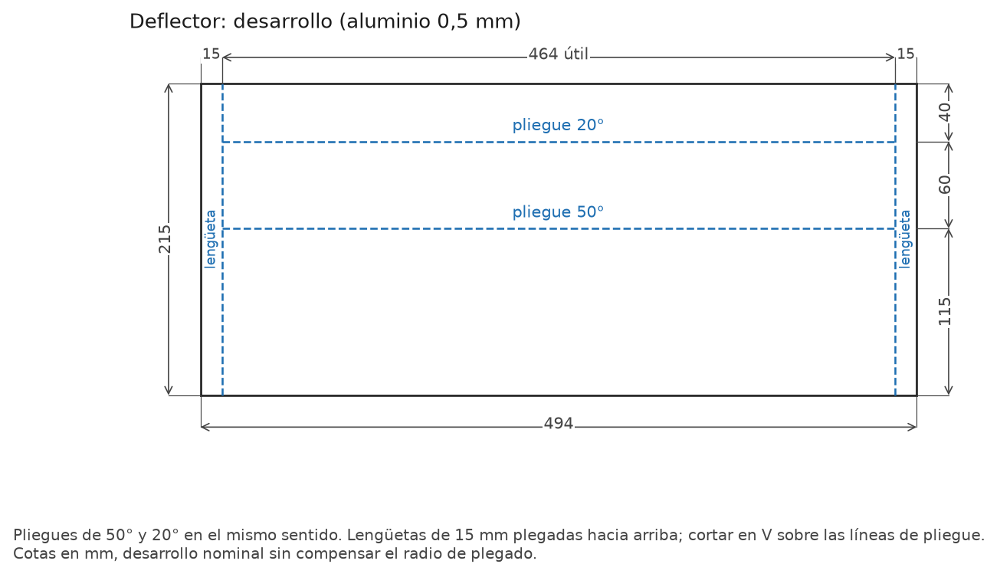
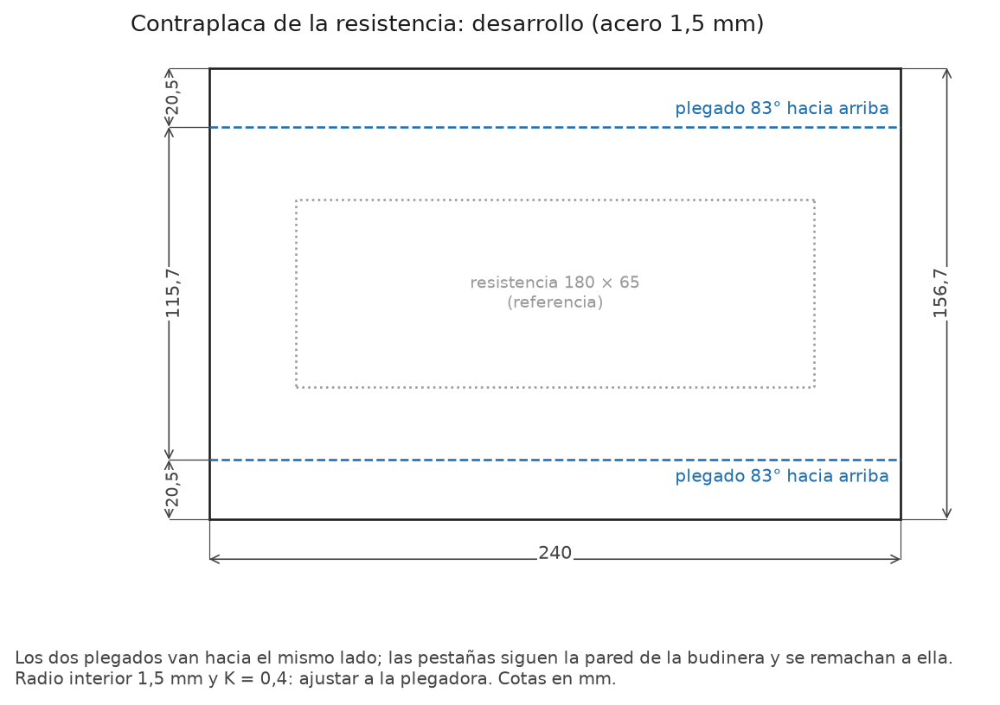
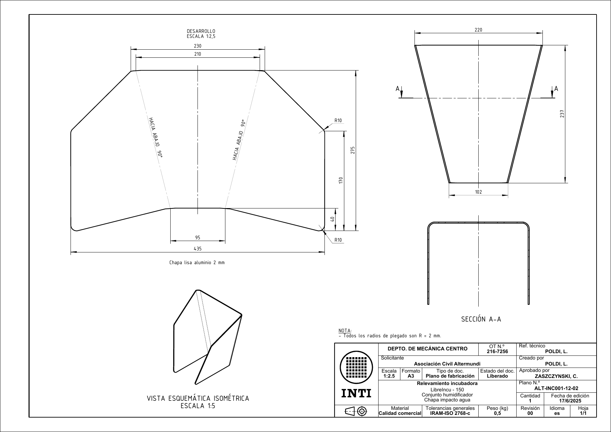
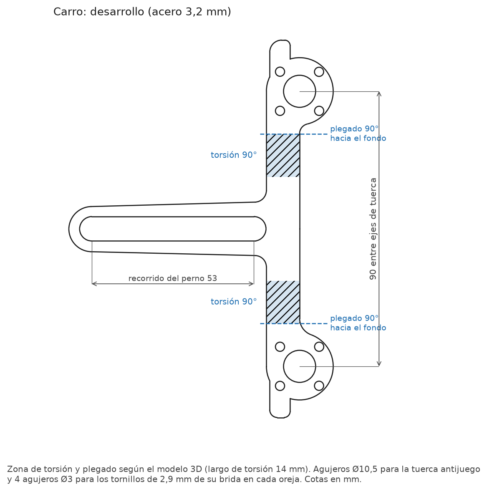

# Compra y corte

Esta página reúne las piezas que hay que cortar o plegar. La lista completa de materiales, con cantidades por incubadora, está en el [inventario](inventario.md).

## Mueble

Placas de MDF melamina blanco de 18 mm. El mueble tiene la cámara de incubación abajo y un cajón de 112 mm de alto arriba, separados por el techo. El cajón aloja el tablero eléctrico y de control, el motor de rotación y la caja estanca de la bomba y la electroválvula, y se abre levantando la tapa superior. La puerta cubre solo la cámara: el frente del cajón queda a la vista.

{ width=560 }

*Figura 2. Mueble con cajón superior: frente sin puerta y corte lateral. Medidas en cm.*

| Pieza | Cantidad | Medida (mm) | Ubicación |
|---|---|---|---|
| Lateral | 2 | 1104 × 500 | Entre la tapa inferior y la superior |
| Tapa superior | 1 | 500 × 518 | Sobre los laterales, el fondo y el frente del cajón; se levanta para abrir el cajón |
| Tapa inferior | 1 | 500 × 500 | Debajo de los laterales |
| Techo (divisor) | 1 | 464 × 500 | Entre los laterales; separa la cámara del cajón |
| Frente del cajón | 1 | 464 × 112 | Entre los laterales, sobre el techo |
| Fondo | 1 | 500 × 1122 | Atornillado por detrás de los laterales y la tapa inferior |
| Puerta | 1 | 500 × 1010 | Delante de la cámara, hasta el canto del techo |
| **Total** | **8** | | |

Las medidas generales del mueble (exterior, cámara y cajón) están en [Dimensiones](index.md#dimensiones).

## Chapas y perfiles

| Pieza | Cantidad | Material | Medida de corte (mm) | Ver |
|---|---|---|---|---|
| Deflector | 1 | Aluminio 0,5 mm | 494 × 215 | [Deflector](#deflector) |
| Contraplaca de la resistencia | 1 | Acero 1,5 mm | 240 × 156,7 | [Contraplaca](#contraplaca) |
| Chapa de impacto del agua | 1 | Aluminio 2 mm | 435 × 275 | [Chapa de impacto](#chapa-de-impacto) |
| Carro del husillo | 1 | Acero 3,2 mm | 74,6 × 123,5, según el [desarrollo](cad/carro_portatuercas_corredera-Body.dxf) | [Carro](#carro) |
| Chapa soporte del ventilador | 1 | Chapa 0,5 mm | 494 × 227: 464 de ancho y pestañas de 15 plegadas hacia arriba | — |
| Soportes de la bandeja nacedora | 2 | Perfil L 20 × 20 × 3,2 | 420 | [Fuente de calor](montaje-mecanico.md#fuente-de-calor) |
| Perfiles L de la budinera | 2 | Perfil L 20 × 20 × 2 | 462: 1 de juego contra cada lateral, para sacar la budinera | [Fuente de calor](montaje-mecanico.md#fuente-de-calor) |
| Muñones de las cunas | 6 | Barra de acero Ø8 | 3 de 22 (lado opuesto) y 3 de 38 (lado del husillo) | [Bandejas](montaje-mecanico.md#bandejas) |
| Varilla de vínculo | 1 | Planchuela 20 × 3,2 | 260 | 3 agujeros Ø8 |

## Deflector

  
  

*Figuras 3 y 4. Chapa del deflector y deflector plegado.*

{ width=640 }

*Figura 5. Desarrollo del deflector.*

| Parámetro del desarrollo | Medida |
|---|---|
| Espesor de chapa | 0,5 mm |
| Largo del desarrollo | 215 mm |
| Ancho útil | 464 mm |
| Pestañas laterales | 15 mm por lado |
| Ancho total, con pestañas | 494 mm |
| Paños | 115 + 60 + 40 mm |
| Líneas de pliegue desde un extremo | 115 y 175 mm |
| Pliegues | 50° y 20°, en el mismo sentido |

1. Cortar chapa de aluminio de 0,5 mm de **494 × 215 mm**: quedarán **464 mm de ancho útil** y pestañas laterales de **15 mm por lado**. El desarrollo está en [`Deflector_Aire.dxf`](cad/Deflector_Aire.dxf).
2. Marcar los pliegues a **115 mm** y **175 mm** desde un extremo: forman paños de 115, 60 y 40 mm.
3. Cortar en V las pestañas sobre las líneas de pliegue.
4. Plegar **50°** en la línea de 115 mm y **20°** en la de 175 mm, en el mismo sentido. Con el paño de 115 mm inclinado 20° hacia abajo, el paño de 40 mm queda vertical.
5. Plegar las seis pestañas de 15 mm hacia arriba y desbarbar.

## Contraplaca

La contraplaca aprieta la resistencia contra el fondo de la budinera. Es una U con las pestañas hacia arriba, que se remachan a los costados de la budinera.

| Parámetro | Medida |
|---|---|
| Material | Acero 1,5 mm |
| Desarrollo | 240 × 156,7 mm |
| Líneas de plegado | 2, paralelas al lado de 240 mm, a 20,5 mm de cada borde |
| Ancho entre plegados | 115,7 mm |
| Ángulo de plegado | 83° hacia arriba, para seguir la pared inclinada de la budinera |

{ width=560 }

*Figura 6. Desarrollo de la contraplaca.*

1. Cortar la chapa de **240 × 156,7 mm**. El desarrollo está en [`contraplaca_desarrollo.dxf`](cad/contraplaca_desarrollo.dxf).
2. Marcar las líneas de plegado a **20,5 mm** de cada borde largo.
3. Plegar las dos pestañas **83°** hacia el mismo lado.
4. Presentar la contraplaca bajo la budinera: las pestañas deben apoyar en las paredes.

## Chapa de impacto

{ width=640 }

*Figura 7. Chapa de impacto del agua, plano ALT-INC001-12-02 del INTI.*

1. Cortar chapa de aluminio de **2 mm** según el desarrollo del plano: **435 × 275 mm**, respaldo trapezoidal de 95 mm abajo y 210 mm arriba.
2. Redondear las esquinas inferiores con radio de 10 mm.
3. Plegar **90° hacia abajo** las dos alas sobre las líneas indicadas, con radio de 2 mm.
4. Verificar la sección: 220 mm arriba, 102 mm abajo y 237 mm de alto.

## Carro

El carro usa la chapa original de 3,2 mm, sin cambiar sus medidas ([`carro_portatuercas_corredera-Body.dxf`](cad/carro_portatuercas_corredera-Body.dxf)). Lleva una ranura horizontal para el perno de la bandeja y dos orejas para las mitades de la tuerca antijuego: cada oreja tiene un agujero de Ø10,5 mm para el cuerpo de la tuerca y cuatro de Ø3 mm para los tornillos de 2,9 mm de su brida.

{ width=420 }

*Figura 8. Desarrollo del carro.*

1. Cortar la chapa según el desarrollo.
2. Torcer **90°** el cuello de cada oreja sobre el eje de la oreja.
3. Plegar cada oreja **90° hacia el fondo**. En planta, el eje de las orejas queda en el plano de la ranura.

La torsión se hace con una plantilla, sobre los 14 mm marcados en el desarrollo.
