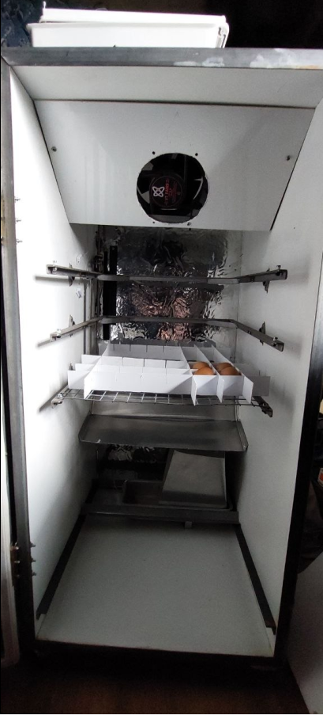

# Manual de fabricación y montaje - LibreIncu 150 v3

Este manual describe cómo fabricar y montar la incubadora LibreIncu 150 v3, un equipo automatizado para incubar huevos con control de temperatura, humedad y rotación de bandejas.

[Empezar](antes-de-fabricar.md){ .md-button .md-button--primary } [Descargar PDF](manual_libreincu_150.pdf){ .md-button }

<iframe src="animacion/rotacion_bandejas.html?embebido" title="Volteo de bandejas en el modelo 3D de la LibreIncu 150 v3" loading="lazy"></iframe>

*Volteo de bandejas en el modelo 3D: arrastrar para girar la vista y Ctrl + rueda para acercar.*

{ width=220 }

*Figura 1. Interior del equipo.*

## Etapas

Las páginas siguen el orden de fabricación.

-   **[Antes de fabricar](antes-de-fabricar.md)**

    Seguridad, herramientas y orden de las etapas.

-   **[Compra y corte](compra-y-corte.md)**

    Materiales, corte de MDF y desarrollos de chapa para cortar y plegar.

-   **[Inventario](inventario.md)**

    Control de las piezas de cada sistema antes de montar.

-   **[Montaje mecánico](montaje-mecanico.md)**

    Mueble, bandejas, rotación, deflector, fuente de calor y humidificación.

-   **[Instalación eléctrica](instalacion-electrica.md)**

    Tablero, placa Olivia, sensores y actuadores.

-   **[Puesta en marcha](puesta-en-marcha.md)**

    Controles sin tensión, primer encendido y pruebas.

-   **[Solución de problemas](troubleshooting.md)**

    Síntomas frecuentes y qué revisar.

-   **[Vista 3D y anexos](vista-3d.md)**

    Vistas del modelo, archivos STEP y DXF, y planos de la v3.

## Dimensiones

Medidas en mm. Las posiciones se toman dentro de la cámara: ancho desde un lateral, profundidad desde el fondo y altura desde el piso o desde el techo (la cara inferior del techo divisor).

### Mueble

| Parámetro | Medida |
|---|---|
| Exterior (ancho × profundidad × alto) | 500 × 536 × 1140; la profundidad incluye el fondo y la puerta |
| Cámara (ancho × profundidad × alto) | 464 × 500 × 974 |
| Cajón superior (ancho × profundidad × alto) | 464 × 482 × 112; aloja el tablero, el motor y la caja de bomba y electroválvula; se abre levantando la tapa superior, con dos bisagras atrás |
| Puerta | 500 × 1010; cubre la cámara, no el frente del cajón |
| Placas | MDF melamina de 18 mm; lista de corte en [Compra y corte](compra-y-corte.md#mueble) |

### Bandejas

| Parámetro | Medida |
|---|---|
| Bandejas | 400 × 400 |
| Ejes de bandeja, desde el fondo | 260 |
| Ejes de bandeja, desde el techo | 255, 375 y 495 |
| Separación vertical entre ejes | 120 |
| Separación entre cuna y lateral | 20 del lado opuesto y 36 del lado del husillo |
| Muñones de las cunas (largo total) | 22 del lado opuesto y 38 del lado del husillo; terminan a 1,2 del lateral |
| Pernos de la varilla de vínculo | 100 del eje, hacia el fondo |
| Varilla de vínculo | Planchuela 20 × 3,2 × 260 |

### Rotación

| Parámetro | Medida |
|---|---|
| Husillo THSL Ø8 × 400 | 15 del lateral izquierdo y 40 del fondo, desde 10 del techo hacia abajo |
| Motorreductor SP 8-18 | Vertical en el cajón, en línea con el husillo; brida de chapa de 0,5 atornillada sobre el techo; largo 110 más la brida |
| Acople 8:8 | 0,5 sobre el KP08 superior, dentro del agujero Ø28 del techo |
| Eje del motor | Sale 28 bajo la brida y queda a 0,5 del husillo |
| Perno del carro (cuna superior) | 40 sobre el eje y 180 hacia el fondo |
| Reed A (superior) | 210 del fondo y 210 del techo, inclinado 30° |
| Reed B (inferior) | 210 del fondo y 305 del techo |
| Imán de los reed (cuna superior) | 55 del eje, hacia el fondo |
| Final de carrera A (superior), rodillo | 40 del fondo y 110 del techo |
| Final de carrera B (inferior), rodillo | 40 del fondo y 350 del techo |
| Giro de las bandejas en los finales de carrera | Unos 24° (A) y 32° (B) |

### Deflector

| Parámetro | Medida |
|---|---|
| Paño vertical, desde el fondo | 60 |
| Punto más bajo, desde el piso | 300 |
| Borde superior del paño vertical, desde el piso | 436 |
| Paños | 115, 60 y 40 |
| Inclinación del paño principal | 20° hacia abajo |
| Pliegues | 50° y 20° |
| Desarrollo | 494 × 215: 464 de ancho útil y pestañas de 15 |

### Fuente de calor y humedad

| Parámetro | Medida |
|---|---|
| Cara inferior de la contraplaca, desde el piso | 8,5 |
| Base de la budinera, desde el piso | 14 |
| Soportes de la bandeja nacedora (cara superior), desde el piso | 55 |
| Perfiles L de la budinera, desde el piso | 55 a 75 |
| Labio de la budinera, desde el piso | 76 |
| Centro de la budinera, desde el fondo | Unos 115 |
| Borde superior de la chapa de impacto, desde el piso | 298 |
