# Manual de Montaje - Incubadora Libreincu 150 v1

## 1. Introducción

Este manual describe el proceso de montaje de la incubadora Libreincu 150 v1, un sistema automatizado para incubación de huevos con control de temperatura, humedad y rotación.

[Descargar manual PDF](manual_libreincu_150.pdf){ .md-button .md-button--primary }

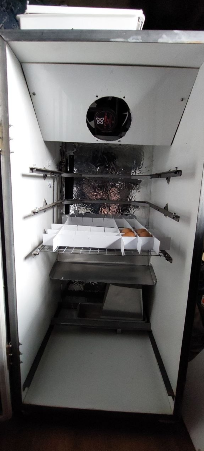{ width=300 }

*Figura 1. Interior del equipo.*

### Dimensiones

| Parámetro | Medida |
|---|---|
| Ancho interno | 470 mm |
| Profundidad interna | 500 mm |
| Alto interno | 970 mm |
| Bandejas | 400 × 400 mm |
| Separación vertical entre ejes | 120 mm |
| Separación entre bandeja pivotante y pared | 30 mm |
| Separación entre eje superior e inferior | 240 mm |
| Altura del deflector desde la base | 300 mm |
| Distancia del deflector al fondo | 70 mm |
| Inclinación principal del deflector | 20° hacia abajo |
| Paños del deflector | 115, 60 y 50 mm |
| Pliegues del deflector | 60° y 30° |

## 2. Componentes del Sistema

### 2.1 Sistema de Control Electrónico

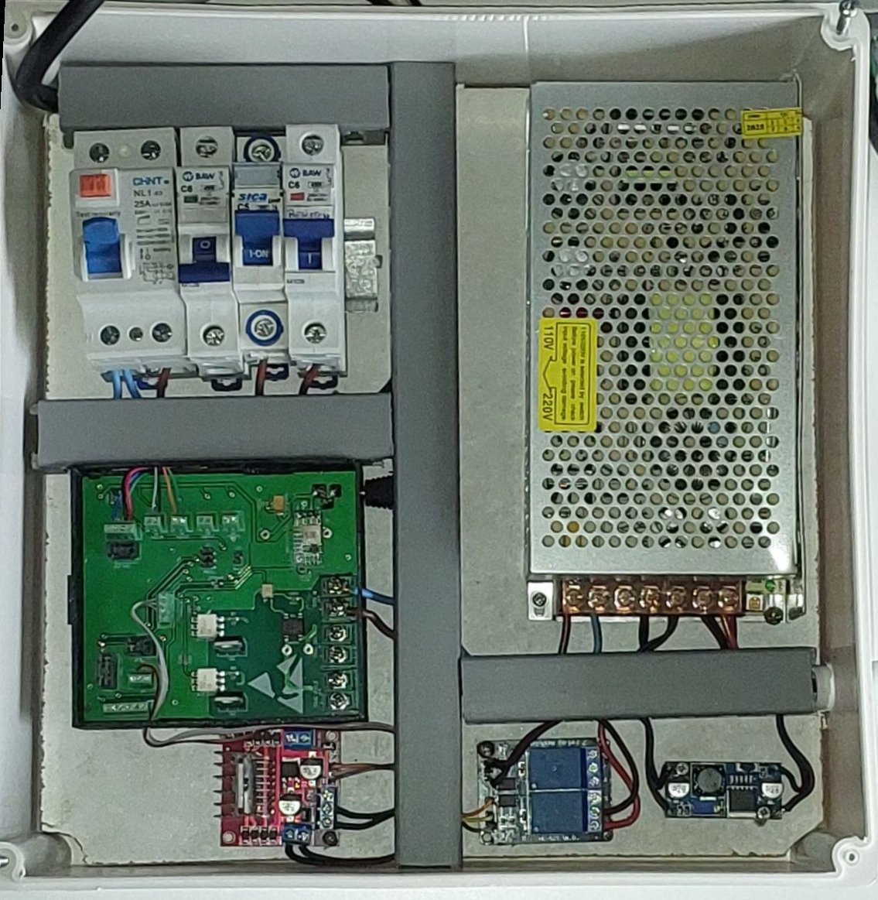{ width=500 }

*Figura 2. Tablero eléctrico del equipo.*

| Componente | Descripción |
|---|---|
| Protecciones | Disyuntor diferencial e interruptores termomagnéticos. |
| Alimentación | Fuente de 220 V CA a 12 V CC y step-down de 12 V CC a 5 V CC. |
| Placa Olivia Control | ESP32 con WiFi; salida TRIAC para la resistencia de 200 W a 220 V CA; comunicación I2C con el BME280; entradas para los sensores de posición de las bandejas y salidas para puente H y relés. |
| Módulo puente H | Control del motor de rotación. |
| Módulo de relés | Control de la bomba del humidificador. |

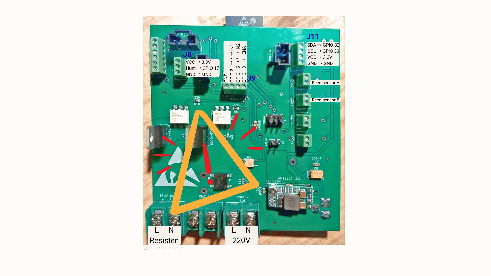{ width=440 }

*Figura 3. Placa Olivia Control V2.*

### 2.2 Sistema Mecánico de Rotación

| Componente | Descripción |
|---|---|
| Soportes de 8 mm | KL08 para las bandejas y KP08 para el tornillo. |
| Transmisión | Soportes, motor, acople de 8 mm y tornillo THSL. |
| Carro de elevación | Dos tuercas THSL; sube y baja sobre el tornillo. |
| Cuna para bandejas | Estante pivotante para bandejas de 40 × 40 cm. |
| Sensores reed | Dos sensores magnéticos para las posiciones superior e inferior. |
| Finales de carrera | Dos interruptores de protección mecánica. |
| Seguidor y perno de bandejas | Oscila en la ranura horizontal del carro. |

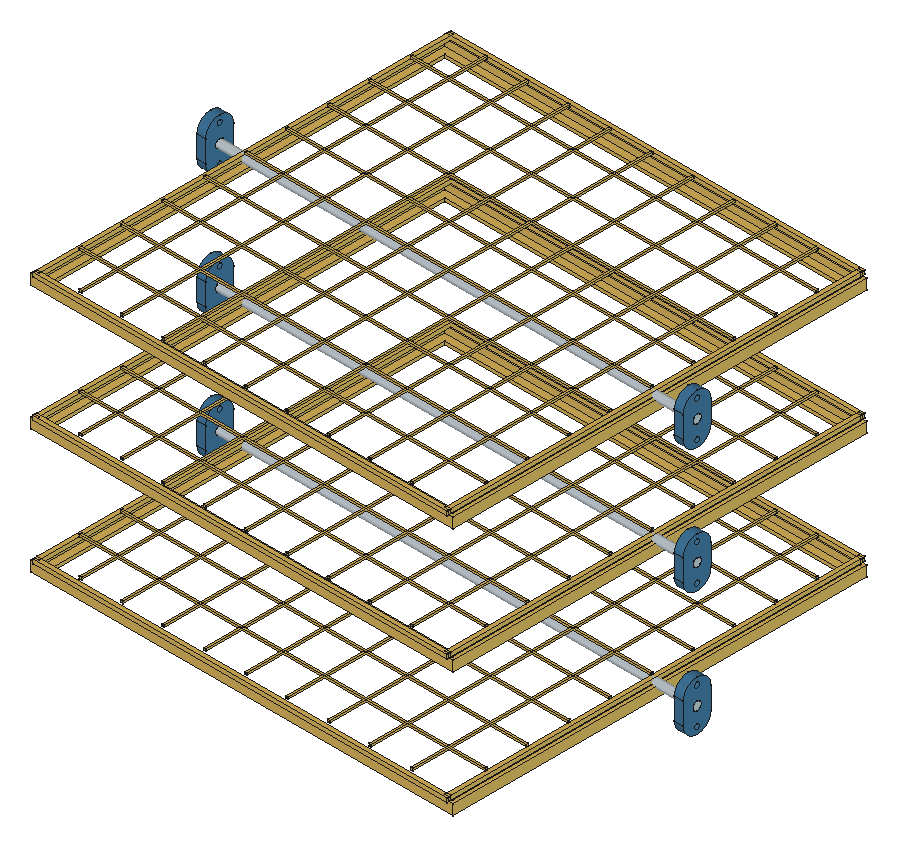{ width=640 }

*Vista CAD de referencia: bandejas, cunas, ejes y soportes, esta vista muestra la disposición general.*

### 2.3 Sistema de Humidificación

| Componente | Descripción |
|---|---|
| Electroválvula | Control del suministro de agua. |
| Bomba de agua | Impulsión de agua al aspersor. |
| Manguera y conector | Manguera de 10 mm y adaptador de 10 a 6 mm. |
| Aspersor | Pico de 6 mm. |
| Soporte del aspersor | Ángulo L empotrado. |

## 3. Preparación del Montaje

### 3.1 Materiales Necesarios

- [ ] Mueble terminado.
- [ ] Tablero eléctrico.
- [ ] Elementos del sistema mecánico de rotación.
- [ ] Sensores reed y finales de carrera.
- [ ] Elementos del sistema de humidificación.
- [ ] Herramientas de montaje.
- [ ] Tornillos y accesorios.

### 3.2 Verificación de Seguridad

- Verificar que no haya tensión eléctrica en el sistema.
- Confirmar que todos los componentes estén presentes.
- Revisar los elementos de protección personal.
- Asegurar espacio y ventilación adecuados.

## 4. Montaje del Sistema de Control

### 4.1 Instalación de la Placa ESP32

Montar la placa Olivia Control en el gabinete previamente acoplado al tablero eléctrico de la incubadora, observando la ubicación de ranuras y orificios para el cableado.

### 4.2 Conexión al sensor BME280

**Conector J11 — I2C.**

  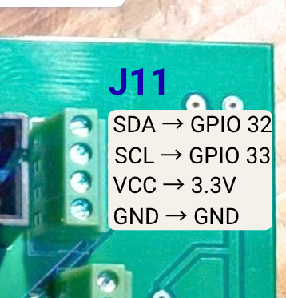
  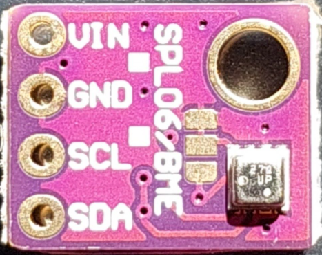

*Figuras 4 y 5. J11 y sensor BME280.*

| Señal de J11 | PinOut ESP32|
|---|---|
| SDA | GPIO 32 |
| SCL | GPIO 33 |
| VCC | 3,3 V |
| GND | GND |

### 4.3 Conexión al relé del Humidificador

**Conector J6.** La alimentación de los relés del módulo, **JVCC**, se conecta a la salida de **5 V CC** del step-down.

  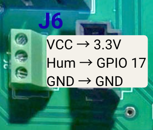
  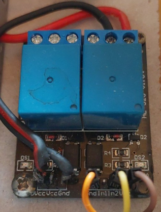
  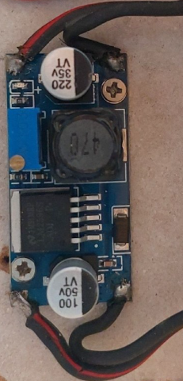

*Figuras 6–8. J6, módulo de relés y step-down. La alimentación JVCC de los relés es de 5 V; Hum/GPIO 17 debe accionar el mismo canal cuya salida NormalOpen conmuta la bomba.*

| Señal de J6 | PinOut ESP32 |
|---|---|
| VCC | 3,3 V |
| Hum | GPIO 17 |
| GND | GND |

Los contactos **NO —normalmente abiertos—** del relé se conectan como interruptor en uno de los cables de alimentación de la bomba de agua.

Conectar **Hum/GPIO 17 a la entrada IN1 o IN2 del canal elegido**. La bomba debe conectarse a la salida NO de **ese mismo relé**. Puede utilizarse cualquiera de los dos canales, siempre que la entrada de control y la salida de la bomba correspondan al mismo relé.

Conectar GND y VCC del módulo a las señales correspondientes de J6, conservando la alimentación JVCC de los relés a 5 V CC.

### 4.4 Conexión al Puente H de Rotación

**Conector J9 — Motor A.** Retirar el jumper que normalmente puentea **ENA** en el módulo.

  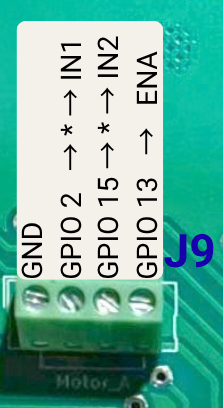
  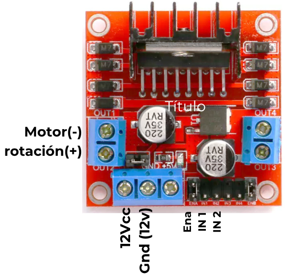

*Figuras 9 y 10. Señales de J9 y conexiones rotuladas del puente H; los asteriscos indican la interrupción mediante finales de carrera.*

| Señal de J9 | Conexión al puente H |
|---|---|
| GND | GND |
| GPIO 2 | IN1, pasando por el final de carrera A |
| GPIO 15 | IN2, pasando por el final de carrera B |
| GPIO 13 | ENA |

### 4.5 Conexiones de Sensores Reed

| Entrada | PinOut ESP32 | Sensor |
|---|---|---|
| Input4 | GPIO 35 | Reed A: posición superior |
| Input3 | GPIO 34 | Reed B: posición inferior |

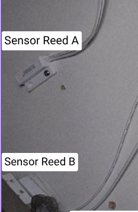{ width=280 }

*Figura 11. Sensores magnéticos de posición superior e inferior.*

### 4.6 Conexiones de Finales de Carrera

Los finales de carrera interrumpen las señales de mando del puente H:

- **Final de carrera A:** interrumpe el cable entre Motor A de Olivia, **GPIO 2**, y **IN1** del puente H.
- **Final de carrera B:** interrumpe el cable entre Motor A de Olivia, **GPIO 15**, y **IN2** del puente H.

## 5. Montaje del Sistema Mecánico

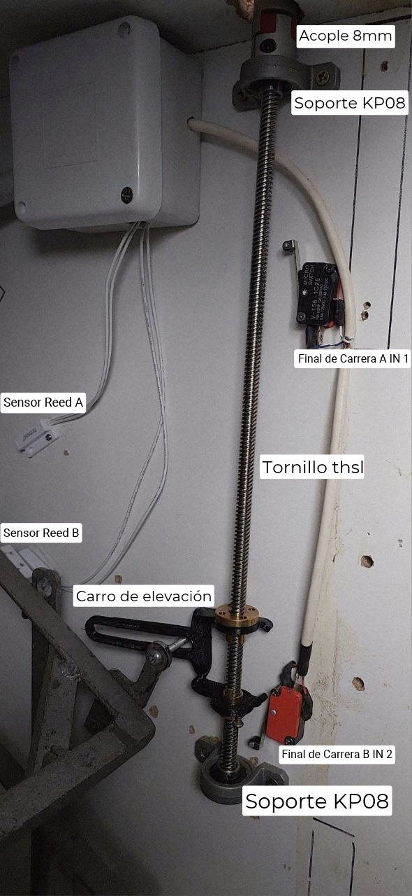{ width=380 }

*Figura 12. Disposición del mecanismo de rotación.*

### 5.1 Ensamblaje del Tornillo de Rotación

1. **Montar el carro de elevación.**
    - Insertar y ajustar las dos tuercas en el carro.
    - Enhebrar el carro sobre el tornillo.
    - Ajustar la altura inicial, de la mitad del husillo hacia abajo.
2. **Montar el soporte del motor y los soportes KP08.**
    - Anclar el soporte superior KP08 al mueble y ajustar el husillo THSL mediante los prisioneros del soporte con una llave Allen de 1,5 mm. Dejar que sobresalga hacia arriba aproximadamente 12 mm.
    - Colocar y anclar el otro soporte KP08 al mueble.
    - Ajustar el acople de 8 mm al motor y al tornillo.
    - Colocar el soporte del motor revisando que las distancias entre acoples no superen 1 mm ni queden apretadas.

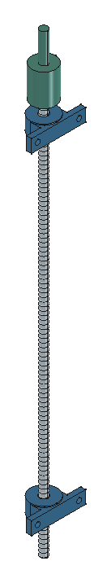{ width=180 }

*Vista CAD de referencia: husillo, KP08 y acople.*

### 5.2 Identificación de los Soportes

  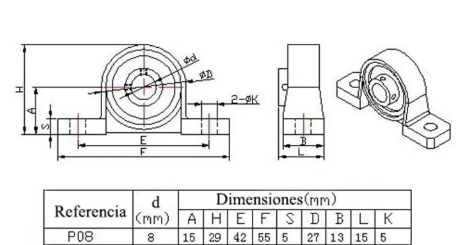
  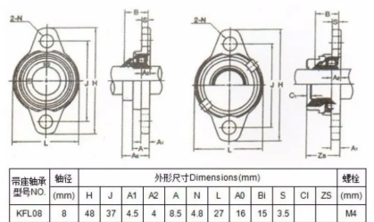

*Figuras 13 y 14. Referencias de los soportes KP08 y KFL08.*

## Deflector

  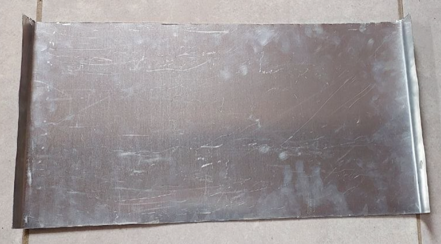
  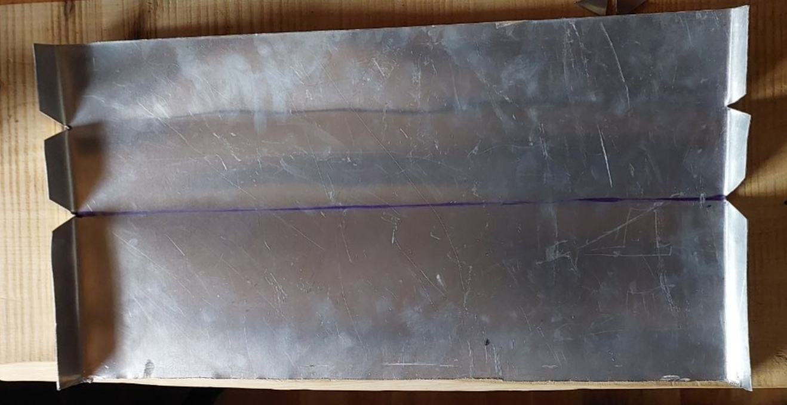
  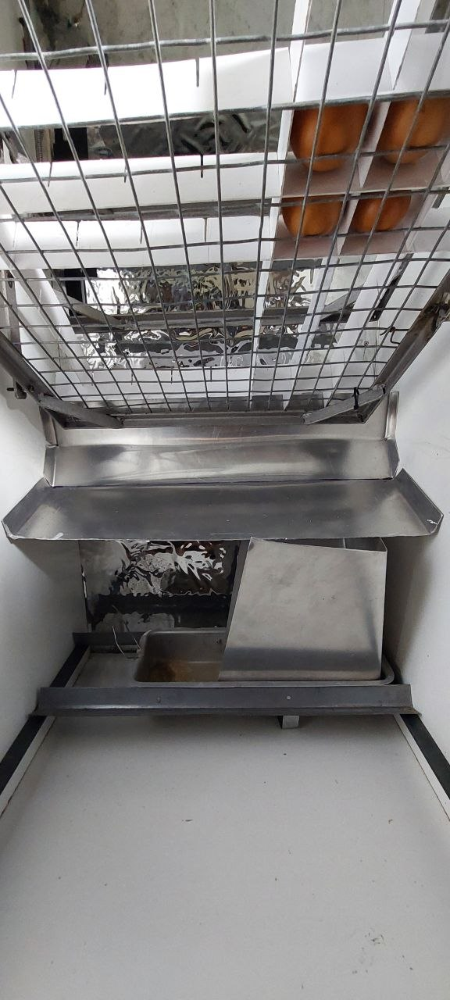

*Figuras 15–17. Chapa del deflector, plegado e instalación debajo de las bandejas.*

| Parámetro del desarrollo | Medida |
|---|---|
| Espesor de chapa | 0,5 mm |
| Largo del desarrollo | 225 mm |
| Ancho útil | 470 mm |
| Pestañas laterales | 15 mm por lado |
| Ancho total, con pestañas | 500 mm |
| Paños | 115 + 60 + 50 mm |
| Líneas de pliegue desde un extremo | 115 y 175 mm |

1. Cortar chapa de 0,5 mm con un desarrollo de **225 × 500 mm**, que deja **470 mm de ancho útil** y pestañas laterales de **15 mm por lado**.
2. Marcar los pliegues a 115 mm y 175 mm desde un extremo, para formar paños de 115, 60 y 50 mm.
3. Cortar las aletas en V sobre las líneas que se van a plegar.
4. Dar al paño principal una inclinación de **20° hacia abajo**, con pliegues de **60° y 30°**, siguiendo la disposición de las fotografías de la fuente.
5. Preparar los seis laterales de 15 mm, desbarbar y verificar que el deflector no interfiera con las bandejas ni las paredes.
